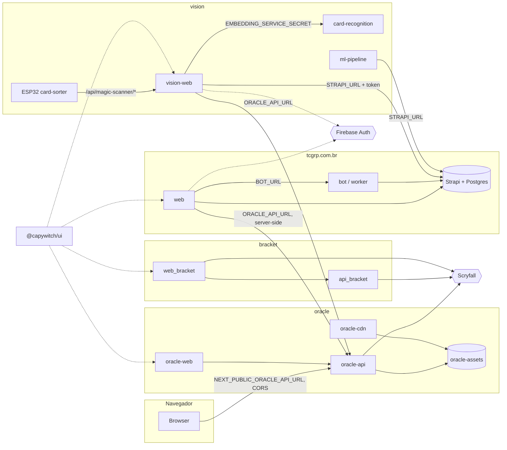

# Arquitetura do ecossistema TCGRP / capywitch

Mapa de como os projetos se conectam e do que compartilham. Gerado a partir do código e dos `docker-compose*.yml`/`.env.example` de cada repo. Itens marcados **(verificar)** não foram confirmados em produção.

## 1. Projetos

| Repo | Domínio | Stack | Papel |
| --- | --- | --- | --- |
| `tcgrp.com.br` | tcgrp.com.br | Next.js 16, Strapi (Postgres), bot WhatsApp, worker, app Expo (monorepo pnpm/turbo) | Plataforma da comunidade: eventos, lojas, RPG, singles tenho/quero, Gestor |
| `oracle` | oracle.tcgrp.com.br, cdn.tcgrp.com.br | FastAPI + Postgres, scheduler, nginx (CDN), Next.js | Catálogo unificado de cartas (Magic, Pokémon, Digimon, Riftbound) + imagens |
| `vision` | vision.tcgrp.com.br | Next.js (`web/`), FastAPI (`card-recognition/`), pipeline ML, firmware ESP32 | Scanner de cartas MTG, ambiente Gestor do scanner, treino |
| `bracket` | bracket.tcgrp.com.br | Next.js (`web/`) + FastAPI (`backend/`) | Análise de decks Commander / brackets |
| `ui` | pacote `@capywitch/ui` (GitHub Packages) | React/Tailwind v4, sem build | Design system compartilhado |
| `crew` | só local/dev | CrewAI + SQLite | Orquestrador de pipelines de agentes (ferramenta de desenvolvimento) |
| `.github` | github.com/capywitch | Markdown | README do perfil da organização |

## 2. Diagrama

## 3. Conexões entre projetos

| Origem | Destino | Como | Config |
| --- | --- | --- | --- |
| `tcgrp` web | `oracle` API | HTTP, server-side (provider de singles, `apps/web/utils/cardProviders/oracle.ts`). Cache 7 d (nome/imagem), 5 min (autocomplete), 1 h (preço) | `ORACLE_API_URL` |
| `vision` web (servidor) | `oracle` API | HTTP, resolve carta por nome/set no ingest do ESP32 | `ORACLE_API_URL` |
| `vision` web (browser) | `oracle` API | HTTP direto do browser (scanner client-side, cache IndexedDB `oracle-cache`) | `NEXT_PUBLIC_ORACLE_API_URL` (build) + `CORS_ORIGINS` do Oracle |
| `vision` web | `tcgrp` Strapi | REST: scanner-amostras, scanner-dispositivos, grupos-de-coleta, cartas-coletadas, cartas, jogos, lojas, usuarios, upload | `STRAPI_URL`, `STRAPI_INTERNAL_URL`, `STRAPI_API_TOKEN`, `NEXT_PUBLIC_STRAPI_URL` |
| `vision` ml-pipeline | `tcgrp` Strapi | Lê amostras/coletas para treino | `STRAPI_URL`, `STRAPI_API_TOKEN` |
| `vision` web | `vision` card-recognition | HTTP interno, alias `vision-card-recognition` na rede `coolify`, porta 9800 | `EMBEDDING_SERVICE_INTERNAL_URL`, `EMBEDDING_SERVICE_SECRET` |
| ESP32 | `vision` web | HTTP `/api/magic-scanner/*` | `DEVICE_INGEST_SECRET` (legado) + secret por dispositivo |
| `tcgrp` web | `tcgrp` bot | HTTP interno | `BOT_URL=http://tcgrp-bot:3001` |
| `oracle` web | `oracle` API | HTTP interno | `ORACLE_API_URL=http://oracle-api:8000` |
| `bracket` web | `bracket` API | HTTP interno, não exposta ao Traefik | `MTG_API_URL`, `MTG_API_KEY` |
| `crew` | `oracle`, `tcgrp`, `ui` | Lê/edita os repos por caminho relativo (`../../oracle` etc.) e roda `verify_command` neles. Não é dependência de runtime | `configs/*.yaml` (`repos`, `llm`) |

`bracket` não chama Oracle, Strapi nem Vision. Compartilha com o resto só o `@capywitch/ui`, o domínio e o Scryfall (próprio cache local).

## 4. Recursos compartilhados

### Infra (Coolify / Docker)
- **Rede Docker externa `coolify`**: todos os serviços expostos entram nela. Comunicação entre stacks é por nome/alias nessa rede (`tcgrp-strapi`, `tcgrp-web`, `tcgrp-bot`, `vision-card-recognition`, `oracle-api`).
- **Traefik** (labels `traefik.docker.network=coolify`) para roteamento e domínios.
- Redes `instance` por stack (`tcgrp-net`, `oracle-net`, `vision`) isolam Postgres e serviços internos.
- Prefixos de serviço (`oracle-*`, `tcgrp-*`) evitam colisão de DNS na rede `coolify`.
- **Cloudflare** na frente do CDN.

### Identidade e segredos
- **Projeto Firebase único**: `tcgrp.com.br` e `vision` usam o mesmo (login Google, Admin SDK). Domínio do vision precisa estar em Authorized domains.
- `EMBEDDING_SERVICE_SECRET`: mesmo valor em `vision-web` e `card-recognition`. O README do `tcgrp.com.br` ainda o lista (herança da época em que o scanner vivia lá) **(verificar se ainda é usado)**.
- `STRAPI_API_TOKEN`: token do Strapi do TCGRP entregue ao `vision`.
- `NPM_TOKEN` (`read:packages`): build secret em `oracle-web`, `vision-web`, `web_bracket` para instalar `@capywitch/ui`.

### Dados
- **Strapi/Postgres do TCGRP**: fonte de verdade de lojas, usuários, cartas coletadas e amostras/dispositivos do scanner. `vision` consome via REST.
- **Catálogo Oracle**: única fonte de cartas para `tcgrp` e `vision`. Substitui chamadas diretas ao Scryfall (spec `tcgrp.com.br/specs/integracao-oracle.md`).
- **Volume `oracle-assets`** (nome fixo): escrito só pelo Oracle, servido por `oracle-cdn` em `cdn.tcgrp.com.br`. Spec 003 prevê montá-lo `ro` no `vision` para dataset/treino; no compose atual do vision ainda **não** está montado.
- **Scryfall**: fonte upstream de Oracle (adapter Magic), `bracket` (bulk + proxy de imagens) e pipeline de dataset do `vision` (`download_scryfall.py`).

### Código
- **`@capywitch/ui`** (`^0.2.1`): tokens de tema, fonte Open Sans, Header/Footer/ZoomableCardImage. Consumido por `bracket/web`, `oracle/apps/web`, `vision/web` com `transpilePackages: ["@capywitch/ui"]` e `.npmrc` apontando para `npm.pkg.github.com`. `tcgrp.com.br` não consome.
- Tipos compartilhados são **por repo** (`tcgrp.com.br/packages/shared-types`, `oracle/packages/shared-types`); não há pacote comum entre repos.

## 5. Pontos de atenção

1. **CORS do Oracle**: o scanner roda no browser em `vision.tcgrp.com.br`. `CORS_ORIGINS` precisa incluir esse domínio, não só `tcgrp.com.br` **(verificar em produção)**.
2. **Doc defasada no `tcgrp.com.br/README.md`**: cita o alias `vision-card-recognition` e `EMBEDDING_SERVICE_SECRET` como se a web do TCGRP chamasse o reconhecimento. O código atual não faz isso; só `vision-web` fala com `card-recognition`.
3. **Acoplamento vision → Strapi**: mudança de schema em `scanner-amostras`, `scanner-dispositivos`, `grupos-de-coleta`, `cartas-coletadas` quebra o `vision`. Sem contrato versionado.
4. **Acoplamento tcgrp/vision → Oracle**: ambos dependem das rotas `/cards/by-name`, `/cards/fuzzy`, `/cards/by-name/{name}/arts`, `/cards/autocomplete`.
5. **Oracle mounted volume**: montagem `ro` de `oracle-assets` no `vision` pendente.
6. **Ordem de deploy**: Oracle → Strapi (tcgrp) → vision → web do tcgrp. `vision` não sobe sem `STRAPI_URL`, `ORACLE_API_URL`, `NEXT_PUBLIC_ORACLE_API_URL` e `EMBEDDING_SERVICE_SECRET` (compose usa `:?`).
7. **`crew`** tem caminhos relativos fixos; exige os repos como irmãos no mesmo diretório.
